# esp8266-proxmox-monitor

<table>
<tr>
<td>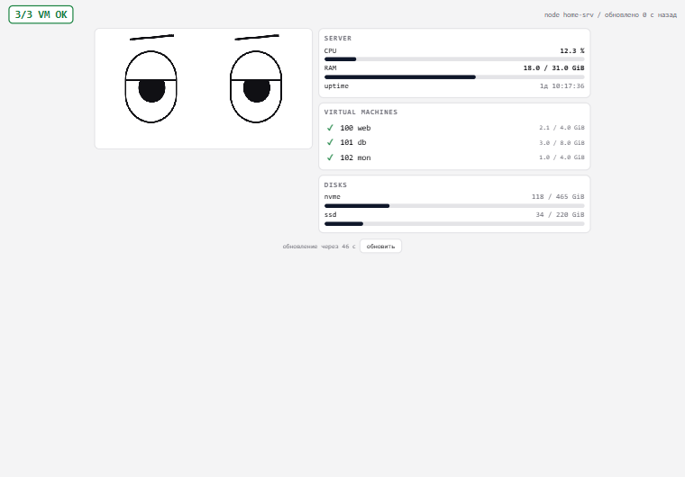</td>
<td>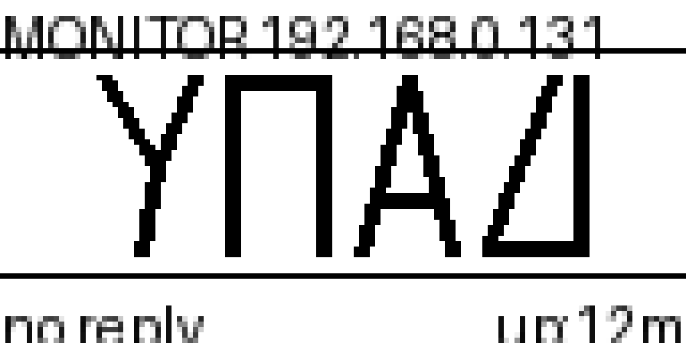</td>
</tr>
</table>

Живой сторож для домашнего Proxmox-сервера. Немного Arduino-магии: NodeMCU (ESP8266) с
дисплеем SSD1306 стоит на полке и **рисует мультяшные глаза**, которые реагируют на всё,
что происходит с сервером:

- хост перестал отвечать — **злые брови, орущий рот и непрерывная сирена** из пьезопищалки;
- легла виртуалка — **три писка** и недовольная физиономия;
- стартовал vzdump — **паника: лапки над глазами и рот-«О»**;
- днём, пока всё спокойно, глаза **живут свою жизнь**: выглядывают из-под век, читают книгу,
  листают TikTok с сердечком, паникуют за клавиатурой, думают о своём и пьют кофе;
- наступила ночь (23:00–07:00 по времени сервера) — экран переворачивается, глаза
  **засыпают, а над ними надувается облачко снов**: Zz, мини-сервер, рыбка, кот и шапка
  с прыгающим помпоном; светодиод притушен, из звуков остаётся только тревога за гипервизор.

Второй «глаз» — веб-страница `/pretty` на том же сервере: те же лица на canvas, те же данные,
но в браузере телефона. USB между ними не нужен — всё живёт в одной Wi-Fi сети.

## Схема работы

```
┌────────────┐  HTTP :8123  ┌─────────────┐  pvesh     ┌──────────┐
│ NodeMCU v3 │◄────────────►│   pxmon.py  │───────────►│ Proxmox  │
│ + SSD1306  │  S|V|D строки│  (systemd)  │ /cluster/… │  (host)  │
│ + пищалка  │              │   + /pretty │            │          │
└────────────┘              └─────────────┘            └──────────┘
      │
      ▼  прямой ICMP-пинг хоста раз в минуту (ESP8266Ping)
```

Сервер ничего не знает о плате: она сама пингует хост напрямую и ежеминутно забирает
статистику у pxmon по HTTP. Нет Wi-Fi или pxmon недоступен — глаза всё равно честно
драматизируют: прямой пинг продолжает работать, сирена объявляет потерю связи.

Приоритет лиц на плате: **авария (гипервизор или ВМ) → паника-бэкап → сон → живая сцена → норма**.
Сцены и сон — надстройка над тревогами: беда всегда важнее, а `SCENES_ON 0` в `monitor_lib.cpp`
возвращает ровно прежнее поведение v1.

## Как выглядят состояния

| день, всё ок | ночная тема |
|---|---|
|  | 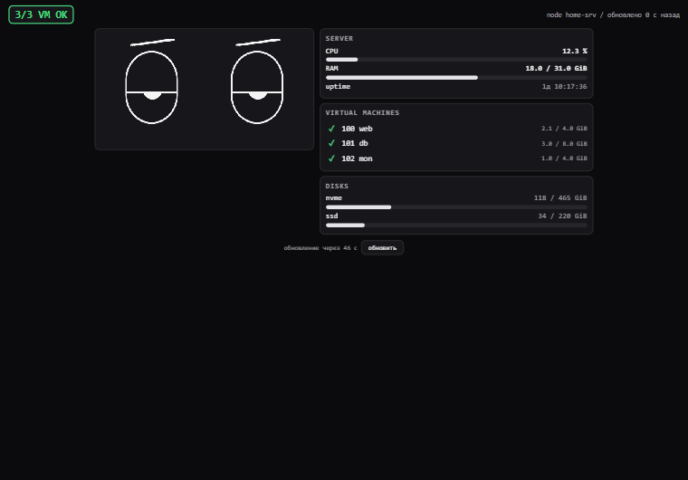 |

| VM легла | идёт vzdump | хост недоступен |
|---|---|---|
| 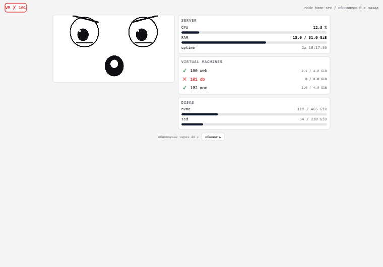 | 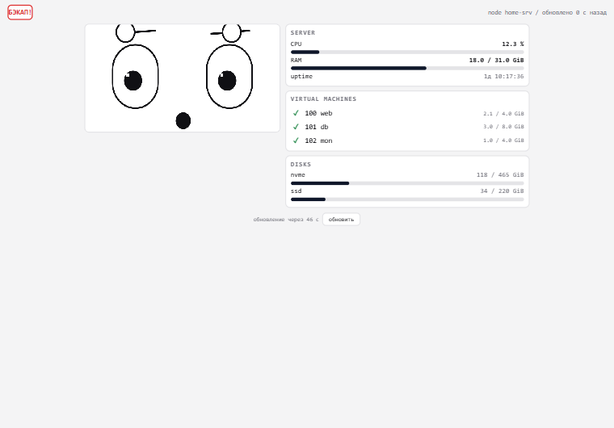 | 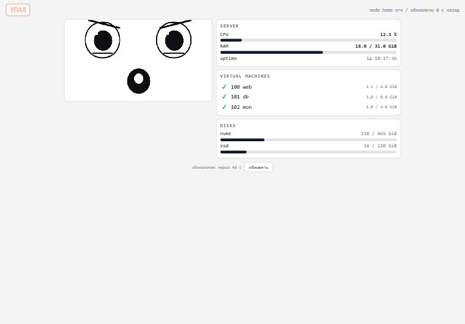 |

Экранные формы OLED (эмуляция буфера дисплея):

| норма | гип недоступен | паника-бэкап | слайды статистики |
|---|---|---|---|
| 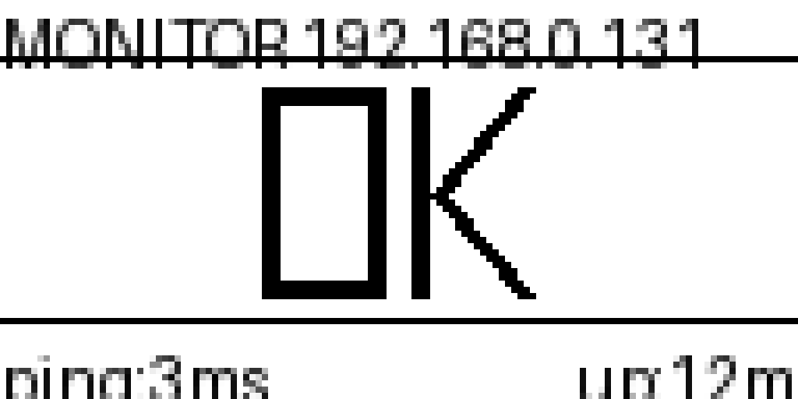 |  | 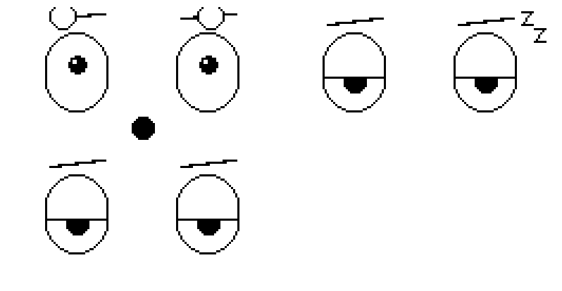 | 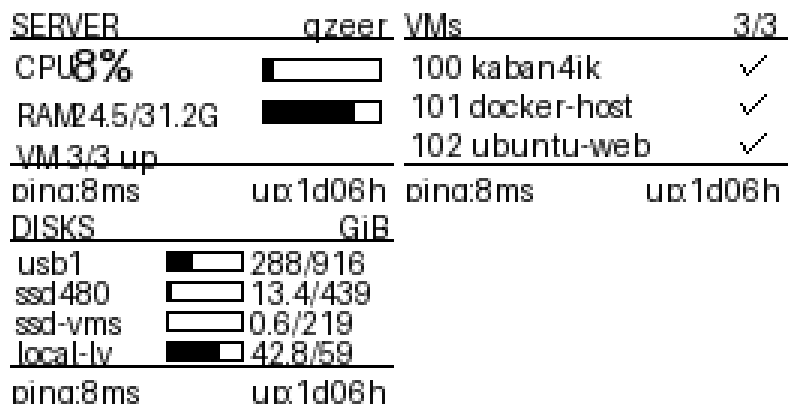 |

## Что умеет плата

- зрачки бродят по глазам, моргают (иногда дважды подряд), «замечают» зрителя,
  обводят глазами круг, прищуриваются — набор привычек для живости
- днём раз в 2–4 минуты играет одну из **6 сцен «живого дня»** (см. ниже)
- ночью спит по-настоящему: веки съезжают, глаза закрываются, надувается облачко снов
- 1–7 января (поле `doy` от pxmon) в зеве бровей появляется **новогодняя шапка**
- раз в 2–3 минуты показывает слайды: 4 экрана по 5 секунд (CPU, RAM, список VM, диски)
- слайды прячутся, пока сервер в аварийном состоянии — авария всегда на экране
- LED «дышит» плавной волной; при «УПАЛ» мигает противным неровным пульсом
- короткий «бип» при включении — сразу слышно, что плата загрузилась

## Сцены «живого дня»

Пока сервер здоров, день и не идёт бэкап, глаза раз в пару минут устраивают маленький
спектакль. Каждая сцена — 4–5 кадров с собственным реквизитом; глаза при этом
переезжают и меняют выражение, как в мультфильме.

| | сцена | что происходит |
|---|---|---|
| 🔍 | **peek** | глаза выглядывают из-под век и шарят взглядом по сторонам |
| 📖 | **book** | читает книгу, зрачки бегут по строкам, в конце — «ах!»-глаза |
| 📱 | **tiktok** | смотрит телефон, в ленте всплывает сердечко-лайк |
| ⌨️ | **pc** | печатает за клавиатурой, ловит курсор, трясёт клавиатуру в панике |
| 💭 | **self** | думает: пузырь мыслей надувается, точки → «!», потом довольные дужки |
| ☕ | **coffee** | жмурится от удовольствия над кружкой-силуэтом |

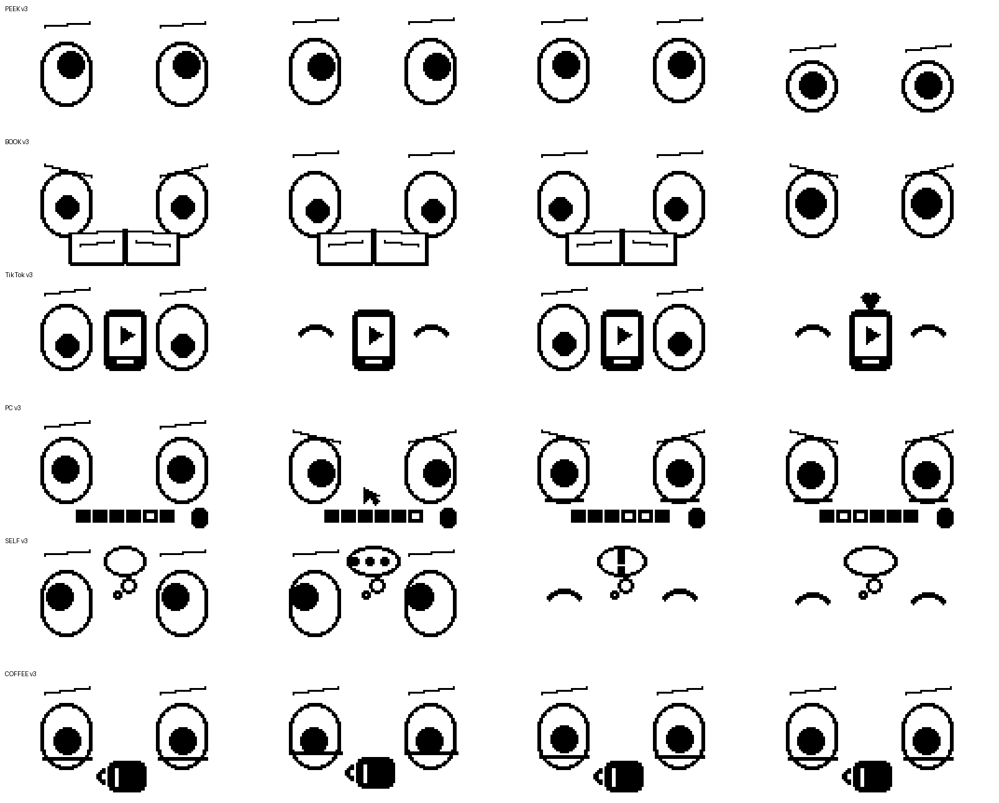

## Стиль v3: контуры 2px и сплошные силуэты

Перерисовал весь реквизит и глаза по правилам FluxGarage RoboEyes и фирменных
лиц Anki Cozmo:

- всё важное — линиями **2px**: на OLED 0.96" штрихи 1px читаются как грязь;
- реквизит — **сплошные силуэты с одной белой деталью**: телефон с белым экраном
  и «play», кружка с бликом, клавиатура — сплошной ряд клавиш, курсор «стрелка»;
- никакого текста-мусора («hm?», «woah!», «+1») — эмоцию несут брови, зрачки и реквизит;
- зрачок сплошной, без блика — как у Cozmo;
- **blink-телепорт**: каждая сцена начинается из мигания — закрыл глаза, открыл
  уже в новой позе;
- живой слой поверх всего: **пружинная догонка позы** с лёгким перелётом, дыхание
  высотой глаз, микро-саккады зрачка, смеющиеся «дужки» тоже дышат;
- после паники или сна глаза выдыхают пару секунд: прищур и брови домиком.

## Ночной сон и облачко снов

Ночью глаза не просто щурятся: веки сползают, глаза полностью закрываются, между ними
надувается пухлое облачко, а в нём по очереди сменяются сны — `Zz`, мини-сервер с
мигающими лампочками, рыбка с пузырьками, кот с усами и хвостом, **новогодняя шапка**
с прыгающим помпоном и блёстками.

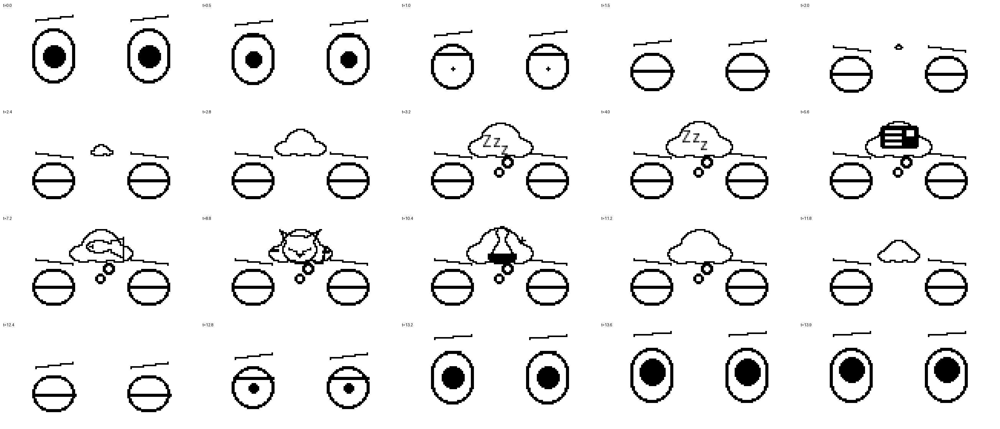

## Демо сцен без сервера

Прошивка понимает команды по USB-Serial (115200) и по HTTP-строке `E|<name>` от pxmon:

```
E|peek   E|book   E|tiktok   E|pc   E|self   E|coffee   E|hat   E|wake   E|none
```

- команда запускает сцену немедленно (сработает даже ночью — поверх сна);
- `E|hat` включает шапку, `E|none` выключает;
- `E|wake` — **не спать 2 минуты**: вечером можно погонять сцены, не трогая ночное
  расписание, а утром проверить, что глаза проснулись;
- после сцены устройство само возвращается к обычной жизни.

Из PowerShell порт надо открывать **без** DTR/RTS, иначе плата перезагрузится:

```powershell
$p = New-Object System.IO.Ports.SerialPort COM3,115200,None,8,One
$p.DtrEnable = $false; $p.RtsEnable = $false; $p.Open()
$p.Write("E|book`n")
$p.Close()
```

## Протокол pxmon

Сервер отдает простой текст, каждая строка — событие:

```
S|node|uptime_s|cpu%|ramMiB|ramMaxMiB|seconds_of_day|backupRunning[|dayOfYear]
V|vmid|name|up|memMiB|maxmemMiB
D|storage|usedGiB|maxGiB
```

- `seconds_of_day` — локальные секунды с полуночи на хосте; плата по ним вычисляет,
  спать или работать (настраивается в коде, у меня 23:00–07:00)
- `backupRunning` — задача vzdump без `endtime` = бэкап идёт прямо сейчас
- `dayOfYear` — необязательное 9-е поле: день года 1..365. Если pxmon пришлёт 1–7,
  на экране появится новогодняя шапка. Нет поля — шапки нет, старые версии pxmon работают как раньше
- диски — топ-4 по объёму, по убыванию

## Веб-дашборд `/pretty`

Один HTML-файл без зависимостей, раздаёт сам pxmon:

- глаза на canvas — порт тех же примитивов из C++ прошивки (те же координаты,
  те же брови и рты), поэтому выглядит как родной
- бейдж статуса: «3/3 VM OK» / «УПАЛ» / «VM ✗ 101» / «БЭКАП!» / «НЕТ СВЯЗИ»
- карточки: CPU и RAM с барами, uptime, список VM (✓/✕ + память), диски
- обновление раз в 60 секунд, вручную — кнопкой у таймера
- **вибро-алерт как на плате**: сирена при падении гипа, три писка при ВМ, ночью молчит
- портрет / горизонталь перестраиваются сами чистым CSS

На телефоне: открыть `http://<proxmox>:8123/pretty`, в Chrome — «Добавить на главный экран».

## Звуковое расписание

| Событие | Звук |
|---|---|
| Включение платы | короткий бип «я жив» |
| Гипервизор недоступен / нет Wi-Fi | **сирена** (вой 2200/1500 Гц) непрерывно, даже ночью |
| Легла виртуалка | 3 писка (1100 Гц) → пауза ~9 с → по кругу, ночью молчит |
| Всё починилось | «динь-дон»; ночью тишина (но в Serial лог пишется) |

## Железо и подключение

- NodeMCU v3 (ESP8266, CH340)
- OLED SSD1306 0.96", I2C, адрес 0x3C
- пьезопищалка из старого корпусного ПК
- светодиод — встроенный (GPIO2)
- dupont-провода; корпус ещё не дорос до 3D-принтера

| Что | Плата | Модуль |
|---|---|---|
| Питание дисплея | 3V3 / GND | VCC / GND |
| Дисплей I2C | D1 / D2 | SCL / SDA |
| Пищалка | **D5** | + (второй провод на GND) |

Опционально последовательно с пищалкой ~330 Ом — гасит громкость.

⚠️ **Что НЕ занимать:**
- `SC` и `SD` — это дублирующие подписи SCL/SDA, дисплей уже сидит на них;
  пищалка на SC не зазвучит, а её ёмкость замылит фронты 400-килогерцовой шины
- D3/D4 и D8 — boot-strap пины; свободны полностью D5, D6, D7

## Установка серверной части

pxmon живёт прямо на хосте Proxmox. Читает `pvesh`, поэтому запускается от root —
у меня это доверенная домашняя LAN. Честное предупреждение: авторизации на порту 8123 нет,
так что наружу (проброс на роутере) этот порт не открывайте.

```bash
scp server/pxmon.py      root@<proxmox>:/usr/local/bin/
scp server/pxmon.service root@<proxmox>:/etc/systemd/system/
systemctl enable --now pxmon
# проверка
curl http://<proxmox>:8123/
```

Для отладки лиц без реальной аварии в `pxmon.py` есть константы
`TEST_FORCE_BACKUP` / `TEST_FORCE_VMDOWN` / `TEST_FORCE_DAY` — в бою все нули.

В браузере тоже есть волшебный ключ: `__demo("down" | "vm" | "backup" | "night")`,
`__demo(null)` возвращает живые данные.

## Сборка и прошивка

Пути в скриптах заточены под мою машину — поправьте под себя за минуту.

```powershell
# один раз: arduino-cli 1.5.1 + ядро esp8266 + библиотеки Adafruit SSD1306, GFX, ESP8266Ping
powershell -File tools\setup_build.ps1

# в monitor_server.ino вписать свои данные:
#   WIFI_SSID, WIFI_PASS, TARGET (адрес хоста Proxmox)

# сборка + заливка на COM3 (NodeMCU 1.0 = nodemcuv2)
powershell -File tools\flash.ps1

# лог Serial на 40 секунд: сам дёргает RTS (ресет) и печатает всё
python tools\serial_read.py 40
```

Ожидаемо в логе при первом старте: `[BEEP] start: boot chirp`, дальше находка дисплея
на 0x3C и данные статистики. Ещё в логе видно подсказку `[SCENE] demo via USB: send line E|<name>`.

Сцены и сон включаются константой в начале `monitor_lib.cpp`:

```cpp
#define SCENES_ON 1   // 0 = чистая v1: только глаза, слайды и тревоги
```

Если сборка ругается на `serial-discovery`/`mdns-discovery` — это безобидный шум
arduino-cli, бинарь всё равно собирается.

## Известные глюки

1. После нечистого ресета SSD1306 иногда не просыпается: в логе `NO devices found`.
   Лечится только полным отключением питания на пару секунд (именно обрубить питание,
   не кнопку RST). Прошивка при каждом старте сканирует I2C заново.
2. `tone()` и LED-ШИМ делят один аппаратный таймер ESP8266: пока пищит пищалка,
   дыхание светодиода замирает, после сигнала восстанавливается само.
3. Ночной recover-«динь-дон» подавлен намеренно: поначалу он исправно будил меня посреди
   ночи, когда заканчивался бэкап. Оставил только тихую запись в Serial-лог.

## Планы

- корпус (уже измерил полку, осталось измерить терпение)
- PIR HC-SR501 на D7 — глаза будут замечать, что ты вошёл в комнату
- токен PVE вместо запуска pxmon от root
- графики за сутки прямо в `/pretty`

## License

MIT — делаете что хотите. Если ваши глаза тоже когда-нибудь скажут «упал» — присылайте скрин :)
